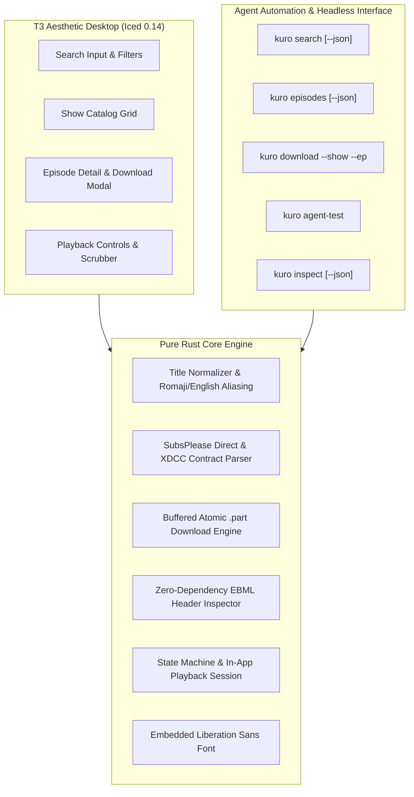

# Kuro

> Minimalist, pure-Rust anime desktop application & autonomous agent-accessible media engine styled after [t3code](https://github.com/pingdotgg/t3code).

[](https://www.rust-lang.org)
[](LICENSE)
[](https://github.com/Aditya-233/kuro)
[](tests/)
[](src/cli/)
[](https://github.com/pingdotgg/t3code)

---

## Overview

**Kuro** is built from scratch with zero system runtime dependencies beyond the standard Linux kernel and dynamic linkers. It runs on minimal Linux environments (including standalone Wayland compositors like `dwl` or `sway`) without requiring heavy frameworks, electron runtimes, or complex C multimedia libraries like GStreamer.

It is dual-mode:
1. **Desktop GUI Mode**: A modern, high-contrast interface rendered with [Iced](https://iced.rs) styled with the exact design tokens of **[t3code](https://github.com/pingdotgg/t3code)**: deep void canvas (`#0A0A0A`), card surfaces (`#111111`), sleek hairline borders (`#1E1E1E`), signature electric blue accent (`#346BF1`), embedded clean sans-serif typography, multi-card catalogs, episode inspectors, direct HTTP download queues, and in-app media playback controls.
2. **Autonomous Agent CLI Mode**: Full headless control for LLMs, autonomous agents, and scripts via structured subcommands with direct `--json` flags.

---

## Architecture & Design Principles



### Key Highlights
- **100% Rust & Maximum Strictness**:
  - `#![forbid(unsafe_code)]`
  - `#![deny(warnings)]`
  - Clippy `pedantic`, `nursery`, `cargo`
  - Disallowed unhandled panics and naked unwraps (`clippy::panic = "deny"`, `clippy::unwrap_used = "deny"`)
- **Embedded Font Guarantee**:
  - Embedded `Liberation Sans` font directly within the binary. Completely eliminates missing glyph boxes (`[]`) and prevents font fallback errors on minimal Linux distributions lacking CJK or specific Latin font configurations.
- **Strictly No Magnet Links**:
  - Respects network restrictions and user preferences. Provides direct HTTP CDN downloads and XDCC bot/pack indexing.
- **Zero Heavy C Dependencies**:
  - Fully avoids external packages like `gstreamer`, `gst-plugins-*`, or bloated system media servers.
- **Atomic Downloads**:
  - Writes to `.part` files in parallel streams and atomically renames upon verification to prevent corrupt or partial media files.
- **Built via Test-Driven Development (TDD)**:
  - 14 integration and unit test suites across all core modules verifying data models, alias normalization, atomic file writing, parser robustness, and player state machines.

---

## Installation & Building

### Prerequisites
Only the Rust toolchain is required:
```bash
# On Arch Linux:
sudo pacman -S rust
```

### Build from Source
```bash
git clone https://github.com/Aditya-233/kuro.git
cd kuro

# Run strict test suite
cargo test --all-targets

# Run strict clippy audit
cargo clippy --all-targets -- -D warnings

# Build release binary
cargo build --release
```

The resulting standalone executable will be located at `target/release/kuro`.

---

## Usage

### 1. Launch Desktop GUI
Simply launch `kuro` without arguments (or with `kuro gui`):
```bash
kuro
```

### 2. Autonomous Agent & Headless CLI Interface

#### Diagnostic Self-Test
Runs the internal test suite verifying all subsystems (aliases, parsers, atomic writers, and playback state machine):
```bash
kuro agent-test
```

#### Search Anime (Human or JSON mode)
```bash
# Human readable table
kuro search "Solo Leveling"

# Machine-readable JSON output for agents
kuro search "Solo Leveling" --json
```

#### List Episodes
```bash
# Formatted list
kuro episodes "Solo Leveling"

# JSON format
kuro episodes "Solo Leveling" --json
```

#### Search with Smart Aliasing
Resolves English and Romaji variations automatically (e.g. *The Quintessential Quintuplets* -> *Go-toubun no Hanayome*):
```bash
kuro search "The Quintessential Quintuplets"
```

#### Direct Episode Download
```bash
kuro download --show "Solo Leveling" --ep 1 --quality 1080p --output-dir ~/Downloads
```

#### Inspect Media File
```bash
kuro inspect ~/Downloads/sample.mkv --json
```

---

## T3-Code Color Palette & Design Tokens

Kuro incorporates the dark theme color tokens from [t3code](https://github.com/pingdotgg/t3code):

| Color Element | Hex Code | Purpose |
| :--- | :--- | :--- |
| **Canvas** | `#0A0A0A` | Deep void background |
| **Surface** | `#111111` | Card containers and elevated panels |
| **Surface Raised** | `#161616` | Element hover and active states |
| **Border** | `#1E1E1E` | Sleek, subtle 1px hairline dividers |
| **Border Highlight** | `#2E2E2E` | Card outlines and modal boundaries |
| **Accent Primary** | `#346BF1` | T3 signature electric blue for key action buttons |
| **Accent Hover** | `#3061D9` | Button hover feedback state |
| **Success** | `#10B981` | Direct CDN and completed indicators |
| **Text Primary** | `#F5F5F5` | Headings, active text, and high-contrast labels |
| **Text Muted** | `#818181` | Secondary metadata and helper labels |

---

## License

MIT License. See [LICENSE](LICENSE) for details.
